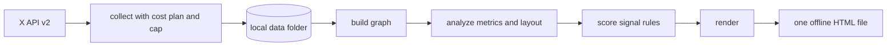

# VisualX_AI

VisualX_AI is a local Python tool that builds a private, interactive map of your X network. It collects the public interactions around your own X account (replies, quotes, mentions, and reposts) through the official X API, builds a weighted interaction graph, and calculates network metrics. It also gives each account a signal state from explainable rules for spam, automation, and impersonation, with the cause of each signal.

The output is one HTML file with a dark-theme WebGL graph. It opens offline and does not use a server.

## How it works



Only the `collect` stage spends money. It shows the cost of each step before the step starts, and it stops before your spend cap. Every other stage reads local files, so you can change rules or weights and re-render for free.

## Runtime

| Item | Value |
|---|---|
| Operating system | Windows 11 |
| Python | 3.12 |
| Main libraries | python-igraph (metrics and layout), httpx, keyring, Jinja2, PyYAML, Typer |
| Page | Sigma.js 4.0.4 and graphology 0.26.0, inline in the file, pinned in `src/visualx/render/vendor/VENDOR.lock` |
| Data access | Official X API v2 (default), pay-per-use, OAuth 2.0 with PKCE. Optional: xAI Grok `x_search` (`--source grok`). |

## Install and test

```text
uv venv --python 3.12
uv pip install -e ".[dev]"
.venv/Scripts/python -m playwright install chromium
.venv/Scripts/python -m pytest                 # unit, end-to-end, and browser tests
.venv/Scripts/python -m pytest -m slow         # 10k-node performance tests
.venv/Scripts/python tools/release_checks.py   # secret scan, license check, policy checklist
.venv/Scripts/python tools/validate_detectors.py  # detector recall and precision on the benchmark (about 1 minute)
.venv/Scripts/python tools/validate_grok.py    # Grok items against the X API data in the store (no API call)
.venv/Scripts/python tools/vendor.py verify    # vendor JavaScript against VENDOR.lock
```

## First setup (OPR-01)

1. Make a developer account and an app at console.x.com. Set OAuth 2.0 to a native (public) app, and add the callback URL `http://127.0.0.1:8765/callback`. The port must agree with `owner.redirect_port` in `config/visualx.toml`.
2. Buy a small credit package and **set a spend limit in the X Console**. This limit is the external hard limit. The `--cap` of the tool is the second limit.
3. Put the app's OAuth 2.0 client ID in `config/visualx.local.toml` (not in version control):

   ```toml
   [owner]
   client_id = "your-client-id"
   ```

   `owner.handle` is `Ron_Dilley` in `config/visualx.toml`. The collector stops if the signed-in account is a different account.
4. Run `visualx auth login`. A browser opens at X. After you give approval, the tokens go into the Windows Credential Manager. They do not go into a file.
5. Optional: run `visualx auth status`. It makes one live `GET /2/users/me` call (one user read, $0.010) and shows the account.

## Use (OPR-02)

```text
visualx collect --dry-run                 # the plan and the cost estimate, no API call
visualx run --days 90 --cap 10            # collect, build, analyze, score, render
visualx run --skip-collect                # a new map from the stored data, no API call
```

After a complete run, the next `collect` or `run` is incremental (FR-08). Steps 1 and 2 get only the posts and mentions that are newer than the stored ones, and steps 3 and 4 look only at the new posts. Use `--full` to collect the full window again, for example to get new quotes and reposts of older posts. A window that starts before the last complete window also gives a full run.

`run` gets your approval before each paid step. It shows the estimate, the unit prices, and the two billing assumptions that are not verified (OQ-01, OQ-02). If the cap stops the collection, the next `collect` continues from the cursor and does not pay again for pages that it has.

### Calibration (FR-38)

The benchmark numbers come from test data. Your labels measure how correct the tool is on your own network.

```powershell
visualx calibrate sample                 # a sample of accounts and a blind labeling sheet in data\calibration
visualx calibrate import data\calibration\labels_<batch>.csv
visualx calibrate report                 # the share of "concern" for each state, rule, and detector
```

- The sample has all or up to 20 accounts of each of `many_signals` and `some_signals`, up to 10 members of the findings of each detector, and 30 random `no_signals` accounts.
- On the sheet, open each `profile_url` and write `concern`, `fine`, or `unsure` in the `label` column. Leave a row empty to skip it.
- The sheet does not show what the tool thinks, so the tool does not change your label. The rows are in random order.
- The report shows a 95 % interval for each value. With a small number of labels the interval is wide. A new batch selects accounts that you did not label before first.
- The sheet names other accounts. Keep it private, like the map. `visualx delete` also removes an account from the sheets.

### Seed accounts (FR-07)

With only your own posts and mentions, the map is a star: almost each link touches your account. Seed collection also reads the recent posts of your top contacts. Then the map shows the links between your contacts, and the community and pattern stages have data to work on.

```text
visualx collect --dry-run --seeds 40      # the seed list and the cost, no API call
visualx run --seeds 20 --cap 15           # collect with 20 seeds, then build the map
```

- The seeds are the top N accounts by tie weight to you, from the interactions in the store. The tie weight is the same value that the build stage calculates. These accounts are not seeds: your own account, provisional IDs (`h:<handle>`), accounts with `protected = true` in the profile, and accounts that X did not give a profile for. Accounts on the allowlist can be seeds.
- Step 6 reads one page of up to 100 posts for each seed (`GET /2/users/:id/tweets`). It reads the posts from the last 30 days. If the window is shorter, it reads the posts in the window. These reads are not owned reads, so each post costs $0.005.
- **Cost:** the maximum is seeds x pages x 100 posts x $0.005. That is $0.50 for each seed: $10.00 for 20 seeds and $20.00 for 40 seeds. A seed with fewer posts in the last 30 days costs less.
- Each seed call needs $0.50 of the cap free, so the default cap ($5.00) can stop the step before the last seed. Give a larger `--cap` for more seeds.
- Step 6 has its own estimate and approval, and each call reserves its maximum cost before the tool sends it. Step 6 runs before step 5, so the profile lookup includes the accounts that the seed posts add. The approval for step 5 then shows the exact count.
- On an incremental run, the tool gets only the new posts of each seed (`since_id`): the posts after the newest post that it read from that seed before. A new seed gets the full 30 days.
- The default is `collect.seeds = 0` (off). `collect.seed_window_days` (30) and `collect.seed_pages` (1) in `config/visualx.toml` change the period and the number of pages.

### v0.2 tools

```text
visualx import-archive <archive.zip> --dry-run --days 0   # read your X archive, report its files, write nothing
visualx import-archive <archive.zip>                      # import your own outbound posts (free)
visualx export --format gexf                              # a .gexf file for Gephi, in data\exports
visualx export --format xnm                               # interactions.json and profiles.json (x-network-map shapes)
visualx render --redact                                   # a map with the structure only
visualx snapshot diff                                     # counts of the changes since the snapshot before
visualx sweep --dry-run                                   # the cost to look for posts that are no longer on X
visualx sweep --limit 500 --cap 3                         # paid: check the 500 oldest posts, delete the gone ones
```

- **Archive (FR-06).** Ask X for your data archive (Settings, "Download an archive of your data"). The importer reads only your own posts (replies, mentions, reposts, and quotes), not likes, follows, or private messages. The `accountId` in the archive must be your account. Start with `--dry-run --days 0`, and look at the list of files that it does not recognize.
- **Communities, hubs, bridges, topics (FR-26 to FR-30).** The analyze stage calculates them with no API call. In the Controls drawer, set "Node color" to "Community" or "Bio topic", and use the Community, Bio topic, and "Hubs and bridges only" filters. The account panel shows the community, its stability (the share of the 20 Leiden runs that agree), the role, and the topics. The groups are exploratory: an algorithm made them.
- **Topics.** Edit the keywords in `config/topics.yaml`. A topic is a label on the map only, and no rule reads it. The tool refuses a topic for politics, religion, health, ethnicity, sexuality, or trade-union membership (TR-06).
- **Recency decay (FR-20).** Set `half_life_days` in `[weights]` (for example 90) to give earlier interactions less weight. 0 (the default) is off.
- **Rule B06.** Put one domain on each line of `config/threat_domains.txt`, from a threat feed that you select. Write the terms of use of the feed in `feed_terms` of rule B06 in `config/rules.yaml`. With no file, B06 is off.
- **Exports (FR-51).** The export files hold no signal state, rule result, or finding. They describe third parties, so keep them private. `visualx delete` also deletes each export file that holds the ID.
- **Redacted map.** `render --redact` writes `map_<id>_redacted.html` with no handle, name, ID, profile, topic, state, or finding. Use it when you show the map to other persons.
- **Snapshots (FR-61).** Each render keeps a snapshot. After the next collection, the map shows what changed: the "Changes" card in the Overview, the "Changes since the last snapshot" filter, a "new" mark on new findings, and a "Since" part in the account panel. `visualx snapshot list` lists the snapshots, and `visualx snapshot diff` prints the counts of the changes (no names).
- **Sweep (DR-05).** The sweep sends your stored post IDs to X in calls of 100 and deletes the posts that X reports as not found. Each post ID costs $0.005. On 2026-11-03 the store had 3,252 post IDs: $16.27 for a full sweep. `--limit` checks the oldest posts first, and the next sweep continues after them.

After you change `config/rules.yaml`, the weights, or `config/overrides.yaml`, run `visualx score` and `visualx render`. These stages cost nothing.

The map is in `data/renders/map_<id>.html`. Open it in Edge or Chrome. It works offline.

## The map page

- **Top bar:** search (press `/`), time buttons (All, 30 d, 7 d, 48 h), link-type buttons, the Map and Overview views, and the Findings, Playback, and Controls buttons. The `?` button opens a short guide.
- **Map:** move the mouse onto an account to see a card and its links. Click an account to see its details: profile, metrics, signal state, the rules that fired with their causes, and its findings. Drag an account to move it. The buttons at the bottom right zoom in, zoom out, and fit the graph.
- **Controls drawer:**
  - Display: node size and color, labels, link opacity and thickness, and arrow heads.
  - Layout: owner at the center, force (ForceAtlas2 in the page, with sliders), or grouped by state.
  - Filters: signal states, link types, minimum tie weight, accounts with no profile, community, bio topic, changes since the last snapshot, and hubs and bridges.
  - Path finder: the strongest path between two accounts.
- **Findings drawer:** the network-level patterns from the score stage, and the accounts with signals. Click one to show its accounts on the map.
- **Playback:** the network grows on a timeline, with a clock and counters.
- **Overview:** cards for accounts by state, verification type, link types, findings, top contacts, and new links in each period. Below the cards is a table of all accounts. Click a row to show that account on the map.

### Pattern detectors (FR-59)

The score stage runs 12 detectors across accounts. Each finding goes in the Findings drawer with a plain title, a summary, and its evidence. A finding is a reason to look, not a decision about a person.

| Detector | What it looks for |
|---|---|
| `reply_burst` | Many accounts, many of them new, on one of your posts in a short time |
| `creation_cluster` | Accounts that contacted you and were made in the same hours |
| `fast_reply` | Replies that come seconds after your posts, again and again |
| `shared_content` | The same text, link, or site from 3 or more accounts |
| `lookalike` | A handle or display name that looks like your account or a close contact |
| `profile_outliers` | Profile numbers far from the usual range of your contacts (info only) |
| `one_way` | An account that contacts you again and again and gets no response (info only) |
| `tight_group` | Accounts that all reply to or mention each other (info only) |
| `co_action` | Accounts that reply to the same posts of yours at the same minutes, more frequently than chance |
| `profile_change` | An account that changed its handle or name to look like you or a close contact, or that changed its handle 3 or more times |
| `mass_tagging` | An account that tags many accounts with no link to each other, a new set in each post |
| `community_anomaly` | A group of linked accounts that were made in the same weeks |

- `profile_change` compares fetches of one account. Its history starts with the first collection after 2026-11-03, so it can fire only after two collections.
- `co_action` uses replies and quotes to your posts. It has almost no input when a small number of accounts reply to you.
- `community_anomaly` and `mass_tagging` work best with seed accounts (`--seeds`).
- The measured recall and precision of each detector are in `background/2026-11-03_detector_validation.md`. On held-out benchmark data the 4 network detectors have 96 % to 100 %, and `creation_cluster` has the lowest recall (43 %).

### Grok as a second source (FR-09)

```text
# the xAI key comes from xai.key.txt in the project folder (or: visualx auth grok-key)
visualx collect --source grok --dry-run
visualx run --source grok --days 30 --cap 5
```

Grok does not decrease the cost. xAI bills `x_search` for each record: $5 for 1,000 posts and $10 for 1,000 profiles, with no de-duplication, plus tokens (docs.x.ai, 2026-11-02). The X API Owned Reads for your own posts and mentions cost $0.001 for each post. The xAI API has no limit on the posts that one request fetches. So the cap reserves `grok.reserve_per_request_usd` for each request, and one request can cost more.

The Grok output is model text. The adapter keeps an item only if its post ID is in the citations that the xAI server returned. It gets the time from the post ID, and it does not store the model's copy of the text. Grok gives handles, not user IDs, so accounts that are not in the store at this time get the provisional ID `h:<handle>` and the state `not_scored`. Reposts by other accounts are not available from `x_search`.

## Content deletion (OPR-03)

If X or an X user asks you to delete content, do it in 24 hours or less:

```text
visualx delete --user-id 1234567890       # repeat --user-id or --post-id for more IDs
visualx delete --post-id 1850000000000000000
```

The command removes the ID from the store tables and from the raw cache files. It also removes the override entry, deletes each rendered HTML file and each export file that holds the ID, and makes a new render. Then it searches all of these locations again, with the HTML data decoded, and stops with an error if it finds the ID (TSC-09). The logs hold IDs only as HMAC values. The command cannot find copies that you moved out of the `data/` folder.

## Privacy

The HTML file contains signal states about third parties. Keep it private. Do not publish or share it. See `docs/VISION.md` §6.

## Status

| Item | State |
|---|---|
| Version | v0.1, with the v0.2 code. Live runs against the X API and xAI on @Ron_Dilley since 2026-11-03. The v0.1 gate in `tasks/todo.md` has no open item. The owner closed the cost check (BSC-02a) because the difference is not material. |
| Tests | 551 tests (unit, end-to-end, browser in headless Chromium and Edge, and the detector benchmark) have no failures. The 4 slow tests also have no failures. |
| Frame time | Headed Edge and Chrome on the owner workstation: 18 ms mean at 5k nodes, 24 to 34 ms at 10k nodes with the v0.2 page (7 of 8 runs at 33 ms or less), 10 ms on the live map (`background/2026-11-02_browser_probe.md`). |
| Live data | 90 days and 20 seed accounts: 1,066 accounts and 1,206 links. 31 rules (B06 off, no feed) and 12 pattern detectors, and these findings: 1 lookalike of the owner account (high) and 10 profile outliers (info). Groups: 18 Leiden communities, 22 hubs, 22 bridges, 368 accounts with a topic. |
| Validation | Grok: 96 % agreement with the X API and 74 % recall. Detectors: see "Pattern detectors" above. |
| Open | The profile history starts with the next collection. Your archive for TSC-02. A live sweep (paid). A threat feed for B06. Detector limits: see `tasks/todo.md`. |

## Companion documents

- [`docs/VISION.md`](docs/VISION.md): direction, bets, and what the tool is not
- [`docs/REQUIREMENTS.md`](docs/REQUIREMENTS.md): requirements with IDs
- [`docs/SUCCESS_CRITERIA.md`](docs/SUCCESS_CRITERIA.md): measurable criteria and the test plan
- [`docs/ARCHITECTURE.md`](docs/ARCHITECTURE.md): the design and the rationale
- [`docs/2026-11-02_X_Network_Analysis_Research.md`](docs/2026-11-02_X_Network_Analysis_Research.md): research survey
- [`VIBE_HISTORY.md`](VIBE_HISTORY.md): session log
- [`tasks/todo.md`](tasks/todo.md): build slices

## License

GPL-3.0. See [`LICENSE`](LICENSE).

Parts of the design (the data contract and the tie-strength formula) come from [poseljacob/x-network-map](https://github.com/poseljacob/x-network-map) (MIT, Copyright (c) 2026 Jacob Posel).
