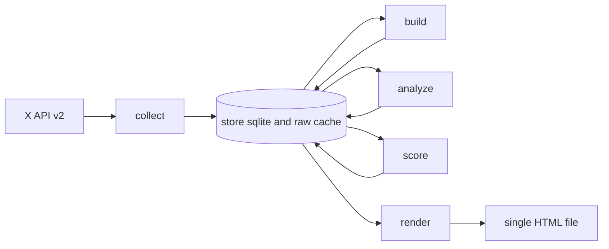
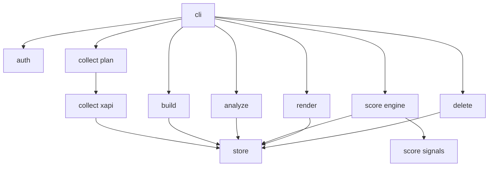
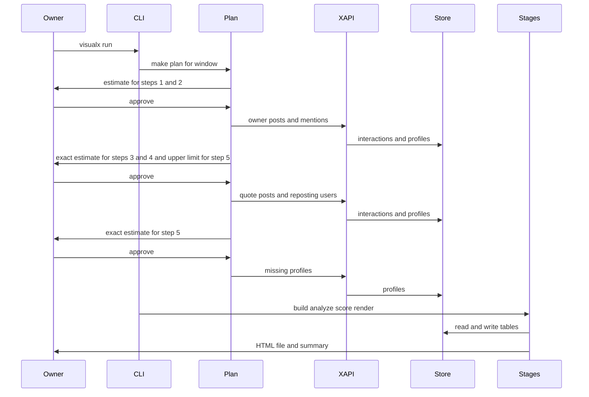

# VisualX_AI — Architecture

**Author:** Ron Dilley (with design guidance from Claude Opus 5.5)

**Date:** 2026-11-02

**Status:** The design of v0.1 and v0.2. This draft includes the changes from the Phase 8 multi-AI review (`.ai-reviews/20261102-151135/synthesis.md`). The v0.1 code and the v0.2 code (2026-11-03) follow this design. §18 tells which v0.2 items have a live check. Section notes dated 2026-11-02 record where the code differs from the first draft.

**License:** GPL-3.0

**Companion documents:** [`VISION.md`](VISION.md), [`REQUIREMENTS.md`](REQUIREMENTS.md), [`SUCCESS_CRITERIA.md`](SUCCESS_CRITERIA.md), [`2026-11-02_X_Network_Analysis_Research.md`](2026-11-02_X_Network_Analysis_Research.md), [`../tasks/todo.md`](../tasks/todo.md)

This document explains *why* each important design decision is the way it is. The research survey mapped what the field knows and where it is uncertain. The Phase 6 review cut the scope, and the Phase 8 review found two design defects and one large simplification. This document picks an answer for each decision and sets the constraints the code has to respect. Read it before you write code.

Each decision has an ID (AD-nn) and states the alternative, why we chose this option, and how it could be incorrect. Appendix A defines the terms.

---

## 1. The shape of the system

Three things make VisualX_AI different from a general-purpose graph tool.

First, **the data costs money, and X sets a price for each resource.** Each post read costs $0.005, each profile read costs $0.010, and the owner's own posts and mentions cost $0.001 [V1-R1]. So the collector is not a simple loop through the API pages. It is a budgeted procedure: it builds a plan, shows the cost, gets approval, and stops before the spend goes above a cap. If a run stops partway through, the next run must not pay again for data that it has in the store.

Second, **the output describes third parties.** Every account on the map gets a signal state. An incorrect state can damage a person, and the X terms restrict this type of analysis (VISION §6). So the signal engine must show the cause of each state and must not guess a missing input. Its output stays in one private file.

Third, **the output is a single file that opens offline.** The page cannot connect to a server, so all data, code, and styles are embedded in it. Text from X ends up in the page, and attackers control that text, so the page is a security boundary, not only a view.

The system is six subcommands around one local store.



| Subcommand | Reads | Writes | Paid calls |
|---|---|---|---|
| `collect` | Configuration, tokens, store | Raw cache, interactions, profiles, cost ledger, cursor | Yes |
| `build` | Interactions, profiles, weights | Tables `nodes`, `edges` | No |
| `analyze` | `nodes`, `edges` | Columns of `nodes` (metrics, x, y) | No |
| `score` | Interactions, profiles, rules, overrides | Tables `rule_results`, `node_states` | No |
| `render` | All tables, template, vendor files | `map_<run>.html`, tables `renders`, `render_members` | No |
| `delete` | Post IDs or user IDs | Removes the IDs from all of the above (AD-10) | No |

Only `collect` spends money. All other subcommands can run again as frequently as necessary, at no cost. This is the most important property of the design.

---

## 2. AD-01: Subcommands connect through one local store

**Decision:** each stage is its own subcommand that reads its inputs from `store.sqlite` and writes its outputs back to `store.sqlite`. A `stage_runs` table records, for each stage, the run ID, the time, the code version, and the `stage_runs` IDs of its inputs. The HTML file is the only output that is not in the store.

<!-- AI review 20261102-151135: gemini — SQLite tables replace the stage gzip files and their hash checks (A-4) -->

**Alternatives:** (a) A single in-memory run that collects the data, does the analysis, and makes the page in one pass. (b) The first draft of this document, which used one gzip JSON file for each stage plus a hash of each input file.

**Why one subcommand for each stage:**

1. **Money.** Collection is the only paid stage. If the analysis or render stage has a bug, the owner can repair it and run that stage again without a new collection. The design has to make that possible.
2. **Iterating on rules and weights.** The owner will change rule thresholds and type weights many times during calibration. Each change should mean rerunning `score` and `render`, not `collect`.

**Why one store and not a file for each stage:** at 10,000 nodes the graph fits in memory. Four gzip files with input hashes would add four schemas, four readers, and a consistency check, and give us nothing that SQLite does not give. A single store also means deletion has one location to look for structured data (AD-10). When a stage sees that a `stage_runs` input is older than the newest upstream run, it tells the owner which stage to rerun.

**Stage freshness (review 20261102-225212).** `Store.check_fresh` checks the full lineage. A stage stops when an upstream output was made from an older output than the newest one. It also stops when two upstream outputs come from different runs of a shared stage. An example is an analyze output and a score output from different builds.

**How it could be incorrect:** a long SQLite transaction can lock the store while a different subcommand runs. **Mitigation:** one owner, one workstation, one subcommand at a time. The CLI takes a lock file at startup.

---

## 3. AD-02: One internal interaction model behind a collector interface

**Decision:** each data source is an adapter that writes two record types, `Interaction` and `Profile`. The analysis stages read only these records (AR-03). v0.1 has one adapter: the official X API v2.

<!-- AI review 20261102-151135: openai — reposts from retweeted_by have no post ID and no time (S-1), grok — field_status in the adapter contract (A-3) -->

```text
Interaction:
  interaction_id          stable hash of (type, source_user_id, target_user_id, source_post_id or target_post_id)
  type                    reply | quote | mention | repost
  source_user_id          required
  target_user_id          required
  source_post_id          optional (null for a repost seen through retweeted_by)
  target_post_id          optional
  interaction_created_at  optional (null when the endpoint does not give it)
  observed_at             required (time of collection)
  conversation_id         optional
  text, text_hash, urls[] optional (AD-11)
  source_endpoint, raw_request_hash, adapter, adapter_version, run_id
  field_status            {field: present | absent | unreadable}

Profile:
  user_id, handle, name, description, url, location, created_at,
  followers_count, following_count, tweet_count, listed_count,
  verified_type, protected, profile_image_url, fetched_at,
  source_endpoint, adapter, adapter_version
  field_status            {field: present | absent | unreadable}
```

**The adapter contract** makes a complete `field_status` necessary on each record, and an adapter cannot write a record without one. This forces each future adapter to tell what it does not know.

**Why an interaction model with optional fields:**

1. **The API gives different information for different types.** Replies, quotes, and mentions come from a post object, which has a post ID, a timestamp, and the text. A repost seen through `GET /2/tweets/:id/retweeted_by` comes from a list of user objects, which has no repost post ID and no repost time.

   The first draft of this document made those two fields necessary for all interactions, which was not possible for reposts. The model currently records the fields that the endpoint gives and marks the other fields as `absent`. It does not invent a post ID or a time.
2. **Deletion.** The x-network-map contract aggregates edges and has no post IDs [V2-R12]. The interaction model keeps a post ID when the API gives one, so the tool can find a post when it must delete it.
3. **Rules must have text and time.** B01 (duplicate replies) uses the text of each reply, and B03 (reply spike) uses the time of each reply. Rules declare their input fields, and a rule ignores records that do not have a declared field (FR-57).
4. **Sources change.** For a new source, only a new adapter is necessary (VISION Bet 1).

**The data missing from `retweeted_by`, and the owner's own reposts.** Reposts of the owner's posts by other accounts come from `retweeted_by` with no timestamp. Reposts by the owner come from the owner's timeline as post objects with a timestamp. Slice 0 proves the field mapping for all four types with actual API responses (`tasks/todo.md` 0a).

**How it could be incorrect:** a future source might give text from a model and not records with X IDs (Grok). **Mitigation:** an adapter must check each item against an ID before it writes a record.

**The Grok adapter (owner decision 2026-11-02, moved from v0.3 to v0.1 as a second source).** `collect --source grok` sends `x_search` requests to the xAI Responses API with a JSON schema for the answer. Rules of the adapter:

1. It keeps an item only if the post ID in the item's URL is in the citations that the xAI server returned for that response.
2. It gets `interaction_created_at` from the post ID (an X snowflake ID holds its creation time), not from the model text.
3. It marks `text` as `unreadable`, because the model's copy of a post is not the post.
4. Grok gives handles, not user IDs. A handle that matches a stored profile gets that profile's numeric ID. Other handles get the provisional ID `h:<handle>`, which is clearly not an X ID. The adapter writes a profile with the handle only, so rule N01 gives `not_scored`.
5. Reposts by other accounts are not available from `x_search`.

Grok does not cost less than the X API: since 2026-09-21 xAI bills $5 for 1,000 posts and $10 for 1,000 profiles fetched, with no de-duplication, plus tokens. The xAI API has no limit on the posts that one request fetches. So the cap guard reserves a configured quantity for each request and stops before the next request. One request can cost more than its reservation.

**The archive adapter (v0.2, FR-06, IR-04).** `visualx import-archive <zip or folder>` reads the owner's X data archive. It costs nothing and makes no network call. Rules of the adapter:

1. It reads the `window.YTD.<name>.partN = [...]` files with `json.loads` after the `=`. It does not run the JavaScript. It reads zip members in memory and refuses a member name with `..`, a drive letter, or an absolute path.
2. The `accountId` in `data/account.js` must be the owner ID in the store (FR-54).
3. It maps only the owner's own posts: replies, mentions, reposts (`RT @` with the ID from `user_mentions`), and quotes. A quoted post in the archive has a handle and no user ID. So the quote target gets the provisional `h:<handle>` ID, as in the Grok adapter. It does not import likes, follows, or private messages.
4. `source_endpoint` names the archive file, and `raw_request_hash` is the SHA-256 of the archive record. This links each event to its record (TSC-02).
5. It reports each file that it does not recognize (IR-04). It writes a `collect` stage record with `source = archive`, so an archive import does not make the next X API run incremental.

The importer has not read an actual archive. TSC-02 stays open until the owner gives one.

---

## 4. AD-03: SQLite store and a raw cache the tool can clean up

**Decision:** `store.sqlite` holds the interactions, the profiles, the raw cache index, the cost ledger, and the collection cursor. It also holds the stage outputs (`nodes`, `edges`, `rule_results`, `node_states`), the run records (`stage_runs`, `renders`, `render_members`), and the overrides the owner imports. Raw API responses go into gzip JSON files, one for each request, with a hash of the request as the file name. The interaction table has no `FOREIGN KEY` to the profile table, because interactions with accounts that have no profile stay in the store (FR-22).

**Profile history.** The `profile_history` table keeps a row each time the handle, display name, URL, or profile image of an X API profile changes. The detector `profile_change` reads it (AD-08). The history starts with the first fetch of each account. A Grok profile does not go into it.

**Alternative:** JSON Lines files for all data (as in x-network-map).

**Why SQLite:**

1. **The collector must have transactions.** A run that stops partway (HTTP 429, a crash, the spend cap) must continue from the last completed page with no duplicate interaction (TSC-05). SQLite gives atomic writes and unique keys with no server, and it ships in the Python standard library.
2. **Deletion must have indexes.** `delete --user-id` must find all interactions, cache files, and rendered files for that user. Indexes plus the `cache_index` and `render_members` tables make that fast.

**Raw cache retention.** The cache lets you rerun for free when a subsequent stage has a bug, but it also holds data that deletion must find. So at the start of each `collect`, the tool deletes cache files older than a configurable age (default 30 days). Deleting a single ID rewrites each cache file that contains it, without the objects that match it (AD-10).

<!-- AI review 20261102-151135: gemini — deletion of a full cache file removes the data of up to 99 other users (A-2) -->

**How it could be incorrect:** at 10,000 nodes and 50,000 interactions, SQLite is more than necessary for this quantity of data. **Mitigation:** the transaction and deletion properties are necessary. The design does not use an ORM.

---

## 5. AD-04: The collector is a budgeted plan, not a loop

**Decision:** collection has two phases. **Plan** works out the steps and their cost from data that is cheap or free. **Run** makes the calls one step at a time. Before each paid step, it shows the cost of the step and checks the cap. `visualx collect --dry-run` runs only the plan and makes no paid calls (FR-13).

The v0.1 plan for a window of N days:

| Step | Endpoint | Billing class [V1-R1] | Calls | Estimate before the step |
|---|---|---|---|---|
| 1 | `GET /2/users/:id/tweets` (owner posts) | Owned read, $0.001 | posts / 100 | Maximum: 3,200 posts [V1-R3] |
| 2 | `GET /2/users/:id/mentions` | Owned read, $0.001 | mentions / 100 | Maximum: 800 mentions [V1-R3] |
| 3 | `GET /2/tweets/:id/quote_tweets` | Post read, $0.005 | One or more for each owner post with `quote_count > 0` | Accurate count from step 1: sum of `quote_count` |
| 4 | `GET /2/tweets/:id/retweeted_by` | User read, $0.010 | One or more for each owner post with `retweet_count > 0` | Accurate count from step 1: sum of `retweet_count` |
| 6 | `GET /2/users/:id/tweets` (seed posts, FR-07, only with `collect.seeds` > 0) | Post read, $0.005 | One page for each seed (`collect.seed_pages`) | Maximum: seeds x pages x 100 posts. Runs before step 5. |
| 5 | `GET /2/users` (profiles) | User read, $0.010 | New user IDs / 100 | After step 1: maximum. After steps 3, 4, and 6: accurate count, with a new approval. |

<!-- AI review 20261102-151135: gemini — the step 5 estimate is not accurate before steps 3 and 4 run (S-2) -->

**Step 6, seed posts (FR-07, owner decision 2026-11-03).** With only the owner's posts and mentions, the map is a star. The community and pattern stages then have almost no links between other accounts. Step 6 reads the recent posts of the owner's top N contacts by the build-stage tie weight (AD-06). The seeds come only from the owner's own interactions in the store. Thus step 6 is part of the owner's map, and it is not a mode to map a different account (FR-54).

The step has its own estimate and approval, and each call reserves 100 x $0.005 before the tool sends it. These accounts are not seeds: the owner, provisional `h:` IDs, accounts with `protected = true` in the profile, and accounts that X did not give a profile for. Allowlisted accounts can be seeds, because the allowlist changes the score and not the collection. Each seed gets one page of up to 100 posts from the last `collect.seed_window_days` (30) days. If the window is shorter, the seed posts start at the window start.

Step 6 runs before step 5, so that the profile lookup includes the accounts that the seed posts add. The step numbers in the cost ledger and the cursor do not change. The seed step has the number 6, and the steps run as 1, 2, 3, 4, 6, 5. A store from before step 6 has cursor rows for steps 1 to 5 only, and it works with no migration.

On an incremental run (FR-08), the tool gets only the new posts of each seed (`since_id`). These are the posts after the newest post that step 6 read from that seed (meta `collect_seed_newest_json`). A new seed gets the full seed window. The seed plan of an open window (meta `collect_seed_plan_json`) keeps the same seeds when a stopped run continues. If the store has a seed post as a mention, the mention record stays, so that the `since_id` of step 2 does not change.

**Limit:** with one page for each seed, the tool gets only the newest 100 posts of a seed. If a seed has more than 100 new posts between two incremental runs, some posts are not collected. More pages (`collect.seed_pages`) cost more.

**Why a plan:**

1. **The owner's posts tell you the cost of the subsequent steps.** Step 1 is cheap ($0.001 per post), and the `public_metrics` on each post include `quote_count` and `retweet_count`. After step 1, the estimate for steps 3 and 4 is almost accurate, and the collector skips posts with a zero count. For an example account with 300 posts, most posts have no quotes, so step 3 makes far fewer than 300 API calls. This gives the largest decrease in cost in the design.
2. **Most profiles come along with the data.** `retweeted_by` gives user objects, and the `includes` from steps 1 to 3 contain the authors. Most of the users that remain for step 5 are users that posts only mention. The tool knows the accurate count for step 5 only after steps 3 and 4. So it shows a maximum first, then the accurate cost, and gets approval from the owner a second time.
3. **The guard checks the cap before each call.** It reserves the maximum cost of a call (page size × unit price) up front, and if that reservation would push the total above the cap, the run stops. This guarantees that **the reserved cost with the configured billing assumptions** cannot go above the cap (TSC-04). The actual bill from X follows X's billing rules, which Slice 0 has to test. The spend limit in the X Console is the external hard limit, and the README tells the owner to set it.

<!-- AI review 20261102-151135: openai — cap guarantee overclaimed while billing assumptions are not verified (S-3) -->

**Unverified billing assumptions** are flagged configuration values (FR-12, FR-16). In v0.1 there are two: X does not bill the expansion objects in `includes` (OQ-01), and Owned Reads apply with the user token (OQ-02). Slice 0 tests the two assumptions with a paid $5 probe. Until then, the estimator shows the two assumptions and the cost if each one is incorrect.

**Rate limits.** The quote and repost endpoints allow 75 requests in 15 minutes for each user [V1-R2]. At 300 API calls for each endpoint, that is about 1 hour for each endpoint. The collector waits for the reset time in the `x-rate-limit-reset` header. It does not change to a different token or app to go around the limit (NFR-05, V1-R8 III.D).

**Cursor.** After each page, the collector writes the next pagination token and the step number to SQLite in the same transaction as the interactions. A restart continues from that point. The raw cache prevents a second payment for a page that the collector received but did not store.

**How it could be incorrect:** X can change prices or billing rules without notice [V1-R1]. **Mitigation:** unit prices are configuration, and each run compares the estimate with the ledger (BSC-02a). From v0.2, the owner also compares the result with the X Console (BSC-02b).

---

## 6. AD-05: OAuth 2.0 PKCE with a loopback listener, tokens in the Windows Credential Manager

**Decision:** the owner signs in one time with OAuth 2.0 Authorization Code and PKCE. The tool opens the browser at the X authorization URL and starts a listener bound to `127.0.0.1` on a free port. The listener accepts one `GET` on `/callback` with a `code` and a correct `state`. It rejects a different path or method, a missing code, a bad `state`, and a second callback, and then it stops. The access token and refresh token go into the OS keyring through the `keyring` package (Windows Credential Manager) as a single JSON value.

**Alternative:** an app-only bearer token in a file.

**Why:**

1. **Owned Reads must have the owner's user context.** Owned Reads apply "only when `{id}` is the authenticated user" [V1-R1]. A bearer token has no authenticated user, so it probably pays the higher price (OQ-02).
2. **Listen on 127.0.0.1 only.** A listener on `0.0.0.0` would let a different device on the network send a forged callback or read the authorization code.
3. **Keyring, not a file.** The Credential Manager keeps the token safe with the owner's Windows sign-in (DPAPI). A file in the project folder can end up in version control or a backup by accident.

**Token errors.** If a refresh gives an error, the tool stops before it makes a paid call and tells the owner to sign in again. `visualx auth revoke` removes the tokens from the keyring and calls the X revoke endpoint.

**How it could be incorrect:** the `keyring` package can stop with an error on a computer with no credential store. **Mitigation:** v0.1 targets Windows 11 only (NFR-06). If the keyring is not available, the tool stops with a clear message. It does not write the token to a file as a fallback.

---

## 7. AD-06: The graph model and interaction types

**Decision:** `build` makes one directed edge for each (source, target) pair. Each edge has a count and the known timestamps for each of the four types. The combined weight comes from configuration:

```text
w(u->v) = sum over types t of  alpha_t * (1 + ln(count_t))      if count_t > 0
w_pair  = (w(u->v) + w(v->u)) * reciprocity_factor               if both directions > 0
alpha   = {reply: 3.0, quote: 2.0, mention: 1.5, repost: 1.0}    (configuration)
```

The start values come from x-network-map [V2-R8]. They are heuristics, not published values (research §4, section 1.3), and calibration in v0.2 may change them.

**The type rules** give each post one type for each target (FR-21):

| Post | Target | Interaction type |
|---|---|---|
| `referenced_tweets.type = retweeted` (owner timeline) | Author of the post that the owner reposted | repost. The "RT @user" text gives no mention. |
| A user in a `retweeted_by` list | Owner (author of the owner post) | repost, with no `source_post_id` and no `interaction_created_at` |
| `referenced_tweets.type = replied_to` | `in_reply_to_user_id` | reply. A mention of the same user in the text does not give one more edge. |
| `referenced_tweets.type = quoted` | Author of the quoted post | quote. A mention of the same user does not give one more edge. |
| All posts | Each other user in `entities.mentions` | mention |

This table combines the twarc-network rule [V2-R24] with the x-network-map rule [V2-R12].

**Missing profiles** (FR-22). If the profile lookup for a user fails, or the cap stops step 5, the interactions stay in the store and the node gets `profile_status = missing`. The page hides these nodes by default and shows how many there are. The metrics include them, because their edges are in the data. `score` gives them `not_scored` (rule N01).

**Why directed edges with counts for each type:** the page colors each edge by type (FR-42), so the type has to survive. Repost and mention networks also have different structure (Conover and others 2011, research §4 section 1.2). So each edge keeps a count for each type, not only a single total.

---

## 8. AD-07: Metrics with the ego removed, libraries chosen by measurement

**Decision:** igraph calculates PageRank, betweenness, and the layout. All metrics on the other accounts use the graph with the ego removed. Path metrics use `distance = 1 / w`.

**Note (2026-11-02, implementation):** the first draft used networkx as the graph model and rustworkx for betweenness. rustworkx has no weighted node betweenness, and FR-25 makes `distance = 1 / w` necessary. So igraph calculates all three, and the project does not use networkx or rustworkx. On the synthetic 10k-node, 50k-edge graph, the metrics use 26 s (most of it weighted betweenness) and the layout uses 1.4 s (`tests/perf/test_analyze_perf.py`).

A start-position matrix turns off the grid speed-up of the igraph layout (about 100 s). So the code sets the igraph random generator with the fixed seed.

| Metric | Library | Graph | Measured at 10k nodes (research §4 section 9) |
|---|---|---|---|
| Degree, weighted degree | Python (edge lists) | With ego (ego edges in a different column) | Less than 1 s |
| PageRank | igraph | Ego removed | 0.01 s (research) |
| Betweenness (exact) | igraph | Ego removed, distance weights | 26 s for all metrics, weighted (project test) |
| Layout | igraph Fruchterman-Reingold | Ego removed, then the tool adds the ego at the center | About 1 s |

**The ego layout procedure** (FR-55):

1. Calculate the layout on the ego-removed graph with igraph Fruchterman-Reingold and a fixed random seed.
2. Translate the result so its center is at (0, 0).
3. Place the ego at (0, 0).
4. Scale each node's distance from the center by a monotonic function of its tie weight to the ego, so strong ties sit near the ego.
5. Add the ego edges after the layout, so they do not move the other nodes.

<!-- AI review 20261102-151135: openai — "ego fixed at the center" had no mechanism (S-6) -->

This also prevents a usual problem: a force layout that includes a node connected to all other nodes tends to pull the full graph into one tight ball around that hub.

**Why remove the ego for metrics:** in an ego network the ego connects to almost all nodes, so almost all shortest paths between two other accounts go through it. If the ego stays in, it gets almost all the betweenness, and the values of the other accounts go to zero (research §4, section 3.1). TSC-10 tests this.

**Why these libraries:** the measurements decided it. networkx betweenness (exact) took 297 s at 10k nodes, and igraph does the weighted calculation in less than 30 s. The networkx layouts took 318 s to 599 s, versus about 1 s for igraph. The project is GPL-3.0, so it can use igraph (AR-01). Every library installs from a Windows wheel with no compiler [M].

**How it could be incorrect:** in v0.1 the ego-only graph has a small number of edges between other accounts. Betweenness will then be near zero for most nodes, and the layout will look like a ring around the ego. **Mitigation:** this is an expected v0.1 result, and it is why communities wait for seed accounts in v0.2. The page tells the viewer about this limit (FR-49).

**Groups (v0.2, `groups.py`).** After the metrics, the analyze stage writes the `node_groups` table. All of it uses the undirected graph with the owner removed:

- **Communities (FR-26):** Leiden (`leidenalg`, GPL-3.0) with the RB configuration model. It runs one time for each of 20 random seeds. The run with the highest quality is the reference partition. A group with fewer than 3 accounts gets no number.
- **Stability (FR-27, TSC-11):** for each account, the mean Jaccard similarity between its reference community and its community in each other run. The page labels the groups as exploratory and shows the value. On the live data of 2026-11-03, all 20 runs gave the same partition (18 communities, modularity 0.87, mean stability 1.0), because each seed account and its contacts make a clear group. A test graph with no structure gives a mean stability below 0.6.
- **Hubs and bridges (FR-30):** a hub is in the top 2 % by degree (5 or more links). A bridge is in the top 2 % by undirected betweenness, or has 2 or more links into each of 2 or more other communities. The directed betweenness of the metrics is 0 for an account that only sends links, so bridges use the undirected value.
- **Topics (FR-28):** keyword rules from `config/topics.yaml` on the profile description, then label propagation: an account with no keyword match takes the topic of half or more of its labeled link weight, with 2 or more labeled neighbors. A topic is a display label only. No rule or detector reads it, and the configuration loader refuses a topic or a keyword for a sensitive category (TR-06).

The page used Louvain in v0.1. In v0.2 it uses the Leiden groups from the payload, so the page, the export, and the panel show the same groups. The `community_anomaly` detector keeps its own Louvain run, because the benchmark measured it with Louvain.

**Snapshots (FR-61, `snapshot.py`).** Each render keeps a snapshot of what it shows: for each account the state, the points, the rules, the community, and the tie weights, and for each finding its detector and members. A render of the same analyze and score outputs uses the same snapshot.

The page compares the snapshot with the one before it: new accounts, accounts that are gone, state changes, new rules, community moves, tie weight changes, and new findings. Leiden numbers its groups again in each run, so each new community is matched to the earlier community that holds most of its accounts. Only a change of that match is a move.

The snapshot tables hold states, so the same limits apply as for the score tables: the details go only into the private HTML file, and `visualx snapshot diff` prints counts only.

**Recency decay (FR-20).** `weights.half_life_days` (0 = off, the default) makes each timed interaction count `0.5 ** (age / half_life)`, with the age from the newest interaction in the store. So a new build of the same data gives the same weights. A sum below 1 counts linearly, so the weight formula stays continuous. An interaction with no time counts 1, because the tool does not make up a time (DR-02).

---

## 9. AD-08: The signal engine — rules as configuration, signal types as code

**Decision:** each rule is a row in `rules.yaml` that names a **signal type** (a Python function), its parameters, its points, its family, and its cause template. A new threshold or keyword is a configuration change, and a new signal type is a code change (MR-03).

```yaml
- id: P01
  family: profile
  signal: account_age_days_at_first_interaction
  when: {lt: 30}
  points: 2
  escalate: {when: {lt: 7}, points: 3}
  cause: "Account created {value} days before first interaction"
- id: I01
  family: impersonation
  signal: name_skeleton_matches_ego
  when: {eq: true}
  hard: true
  cause: "Name looks like your account @{ego_handle}"
```

Each signal function declares its input fields, and the engine reads `field_status` on the profile and on each interaction. If a declared input is `absent` or `unreadable`, the rule gives no result for that account and the engine logs one entry (FR-57). It does not change a missing value to zero.

**How the engine computes the state** (FR-31, FR-35):

```text
if a gate rule fires (N01, N02, N03)                        -> not_scored
elif an owner override exists                               -> override value
elif a hard rule fires (I01 in v0.1)                        -> many_signals
elif total >= 6 and 2 or more behavior or impersonation points -> many_signals
elif total >= 3                                             -> some_signals
else                                                        -> no_signals
```

The bands come from research §5, section 6.1. They are engineering decisions, not values from the literature, and the v0.2 calibration will set them again.

**One fact counts one time (`bands.overlap`, 2026-11-03).** P01, B08, B09, and B10 all fire on new accounts. Before the change, a new account in a `reply_burst` finding got P01 (3) + B08 (1) + B09 (2) = 6 points and `many_signals`, from its age only. In the rule file these four rules are one overlap group, and their points count up to 5 in the total. The rule results keep their own points. On new held-out background seeds, `many_signals` went from 11 accounts to 5 (`background/2026-11-03_detector_validation.md`, change 12).

**A minimum of behavior points (`bands.many_signals_min_family_points`, 2026-11-03).** The total is "the points after the overlap groups". `many_signals` also must have 2 or more points from behavior or impersonation rules, and an overlap group adds only its largest such rule. Before this change, profile points and the 1-point rule B08 gave `many_signals`, which is against the intent of FR-35. The value 2 came from the tune seeds, because 3 removed most planted campaigns from `many_signals`. On new held-out seeds, background `many_signals` went from 3 accounts to 1 (change 13).

**Why rules and not a model:** published classifiers incorrectly flag many humans as bots (41% in one audit, on a test set with 15% bots), and they generalize poorly (research §5, section 1.3). A rule with a cause string is easy to examine and argue with. A model score is not. VISION Bet 2 has the full argument.

**Why typed signal functions and not a rule language:** a small expression language in YAML tends to expand without control. The 30 v0.1 rules use about 28 signal functions. A function is easy to test (TR-01) and declares its own input fields.

**Policy controls in the engine:**

1. Every rule has a `family`. TR-06 gives an error if a rule has no family, or if a rule input or keyword is on the list of sensitive categories. This test proves only that the rule file does not contain the known fields and keywords. But a rule can operate as a proxy for a sensitive category through other terms. The owner's review of each new rule is the second control.
2. State names and cause strings do not contain "legit", "risky", "bot", or "scammer" (TSC-29).
3. Only `render` reads `node_states`, `rule_results`, and `findings`. No export reads them (BSC-05 d).

**The rule set (2026-11-03).** The rule file has 31 rules: the 17 of FR-36, the 7 starter rules of FR-56 (P02, P04, B02, B06, B08, I02, I03), B09 to B12 from the pattern layer, and B13, B14, and I04 from the network detectors. B06 (v0.2) is a hard rule (+6) for a link in a post to a domain on the owner's threat feed, `config/threat_domains.txt`. The owner selects the feed and records its terms in `feed_terms`, and `max_domains` is the size limit. With no feed file, B06 is off, and it reads only post links, so a profile field alone cannot give it (FR-35).

I02 compares each account with the allowlist and with the owner's top 10 contacts. A lookalike of a close contact is a usual attack.

**The pattern layer (2026-11-03, owner request).** Rules look at one account. Some abuse shows only across accounts. So `score/patterns.py` and `score/network.py` run 12 detectors on the full store before the rules, and write the `findings` table:

| Detector | What it finds | Default threshold |
|---|---|---|
| `reply_burst` | Many different accounts on one owner post in a short time | 4 or more accounts in 15 minutes |
| `creation_cluster` | Contacts that were made at almost the same time | 3 or more in 72 h, with a Poisson test for the contact count |
| `fast_reply` | Replies to the owner's first posts in a thread that come very fast | median of 60 s or less for 3 or more replies |
| `shared_content` | The same text, link, or site from many accounts | 3 or more accounts |
| `lookalike` | Two accounts with almost the same handle or name | skeleton match, or a small edit distance |
| `profile_outliers` | Strong statistical outliers in the contacts | robust z of 3.5 or more (median and MAD) |
| `one_way` | Many interactions to the owner with no response | 5 or more in 3 or more posts |
| `tight_group` | Groups of other accounts with mutual links | cliques of 3 or more |
| `co_action` | Pairs of accounts that reply to or quote the same owner posts at the same minutes, more frequently than their reply times explain | 3 or more posts in 10 minutes, Poisson test against the latency distribution, Bonferroni for all pairs |
| `profile_change` | A handle or display-name change that makes an account look like the owner or a known account, or many handle changes | lookalike match after the change and not before, or 3 or more handles |
| `mass_tagging` | An account that tags many accounts with no link to each other, a new set in each post | 3 or more posts with 4 or more tags, 10 or more tagged, 50 % or less tagged again, 20 % or less linked |
| `community_anomaly` | A Louvain community (owner removed) with members made in the same weeks | 4 or more in 30 days, binomial test against the other accounts, Bonferroni for all windows |

Each finding has a plain title and summary, the member user IDs, the evidence (counts, times, IDs, hashes, no post text), and a severity (`info`, `notable`, `high`). Titles and summaries contain no handle or text from X. Members of a finding of severity `notable` or higher also get a behavior rule result (B09 to B14). A `high` rename to look like a known account gives I04 (impersonation). So the state shows the finding, and FR-35 stays correct. The thresholds are in the `patterns:` section of `config/rules.yaml`, and TR-06 also checks that section.

**The network detectors (2026-11-03, owner request).** Four detectors look at structure and history, not at one post:

- `co_action` is the coordination-network method of Pacheco et al. (2021) on the data that the owner can see. Fans and colleagues reply to the same posts, so that is not the test. The test is that two accounts reply at the same minutes more frequently than chance. The chance for each pair on each post comes from the latency distribution of all replies to owner posts with almost the same reach. A fast thread or a viral post has dense latencies, so fast replies there are not a surprise.
- `profile_change` reads the `profile_history` table (AD-03). The store adds a row when the handle, display name, URL, or profile image of an X API profile changes. A rename keeps the creation date, so `lookalike` grades a renamed account that was made years ago down. `profile_change` closes that gap: a change that makes the account look like the owner or a known account is `high`.
- `mass_tagging` is the "near star" of OddBall (Akoglu et al. 2010). The OddBall power-law test needs the full neighborhood of each account, and the collector has it only for the owner and the seeds. So the detector uses the tag list of each post: new targets in each post, and targets with no link to each other.
- `community_anomaly` uses Louvain on the graph without the owner (AD-07), with a fixed random seed. `creation_cluster` looks for 3 accounts in 72 hours in all contacts. A farm that was made in some weeks is not dense there, but it is dense in its own community.

The detectors must have data. An ego-only collection with a small number of contacts gives a small number of findings. This is correct, not a defect: at lower thresholds the live data gave only noise (2026-11-03).

**Measured results (2026-11-03, fourth measurement).** A labeled benchmark (`tests/validation/scenarios.py`, `tools/validate_detectors.py`) makes synthetic stores with the live data shape, seed timelines, profile history, planted campaigns, and hard negatives. It has tune runs and holdout runs. The table gives the holdout results (seeds 531 to 538) and the live results (1,066 accounts):

| Detector | Recall (holdout) | Precision (holdout) | Live findings |
|---|---|---|---|
| `reply_burst` | 100 % | 100 % | 0 |
| `creation_cluster` | 74 % | 85 % | 0 |
| `fast_reply` | 75 % | 86 % | 0 |
| `shared_content` | 100 % | 100 % | 0 |
| `lookalike` | 85 % | 100 % | 1 (high) |
| `profile_outliers` | 50 % | 16 % (info only) | 10 (info) |
| `one_way` | 100 % | 3 % (info only) | 0 |
| `tight_group` | 100 % | 20 % (info only) | 0 |
| `co_action` | 98 % | 100 % | 0 |
| `profile_change` | 96 % | 100 % | 0 (one collection of history) |
| `mass_tagging` | 100 % | 100 % | 0 |
| `community_anomaly` | 100 % | 100 % | 0 |

The values change from one set of holdout seeds to the next. For example, `creation_cluster` had 43 % on seeds 511 to 518. On the background seeds 631 to 638, 1 of 11,091 accounts has `many_signals` and 3.3 % have `some_signals` or `many_signals`.

The `info` detectors make a list for the owner to examine, so a low precision is expected for them. They do not change a state.

The benchmark and the detectors come from the same author. Thus the numbers prove the logic, not the precision on live data. This applies most to the 4 network detectors: their planted campaigns are the campaigns that they were made for. The owner's labels (FR-38) measure that. The full report is `background/2026-11-03_detector_validation.md`.

**Calibration (FR-38, owner decision 2026-11-03).** The benchmark measures the logic. Only the owner's labels measure the precision on live data. `visualx calibrate` has three steps:

1. `sample` makes a stratified sample: the `many_signals` and `some_signals` accounts, the members of the findings of each detector at its detection level, and random `no_signals` accounts. It records a snapshot of the state, the rules, and the detectors of each account.
2. The owner labels each account on a CSV sheet as `concern`, `fine`, or `unsure`, and `import` reads the sheet.
3. `report` gives the share of `concern` for each stratum, rule, and detector, with a Wilson 95 % interval. For `no_signals` the share is the miss rate, with an estimate of the missed accounts.

The sheet is blind: it has no state, rule, or finding, and the rows are in random order. A label that the owner gives without the opinion of the tool is a better measurement. Also, no file other than the rendered page holds the state of an account (invariant 8). The report holds only counts.

A cell from X that starts with `=`, `+`, `-`, or `@` gets an apostrophe, so a spreadsheet does not run it as a formula. Deletion removes the rows of a user from the two tables and from each sheet (AD-10).

**Overrides** live in `config/overrides.yaml` (user ID, state, note, date). `score` imports them, and they stay through subsequent runs (FR-37). The page shows an override together with its note.

**Known limits of the v0.1 ego boundary.** P06 uses the lifetime post rate, so it misses a sudden burst from an account that is not new. B03 sees only replies to the owner: an account that sends 500 replies to other accounts and one to the owner does not fire B03. Seed accounts (FR-07, step 6) add the posts of the top contacts from the last 30 days. Without seeds, the tool cannot see these bursts.

**How it could be incorrect:** rules P01, P05, P06, and P07 can fire on new human accounts. The first run with actual data will probably flag some humans incorrectly. **Mitigation:** profile rules alone cannot give `many_signals` (FR-35). The owner overrides the incorrect states, and those overrides become the first calibration data for v0.2.

---

## 10. AD-09: The renderer — one file, a strict CSP, pinned vendor code, data as an encoded payload

**Decision:** `render` fills a Jinja2 template. It inlines the vendor JavaScript (Sigma.js 4.0.x, graphology, graphology-library), the app script, the styles, and one data payload. The payload is the graph as compact arrays, gzip-compressed and base64-encoded, and the page decodes it with `DecompressionStream`.

**Alternatives:** pyvis (no release since 2023), cosmos.gl (no labels, larger bundle), force-graph (Canvas 2D), or D3 with SVG (research §6, section 1).

**Why Sigma.js 4 and this packaging:**

1. **A test proved it for this use.** The V5 test ran Sigma 4.0.4 with 10,000 nodes and 40,000 edges, inline JavaScript, and a gzip plus base64 payload from `file://`, in a 1.21 MB file. Shortest path worked (research §6, section 3.4).
2. **The payload encoding is a security control.** Base64 text cannot contain `</script>`, so a bio from X cannot close the script element (SR-05). After decoding, all text goes into the page through `textContent` (SR-02).
3. **A strict Content Security Policy.** The template has a `<meta http-equiv="Content-Security-Policy">` with `default-src 'none'; script-src 'unsafe-inline'; style-src 'unsafe-inline'; img-src 'none'; connect-src 'none'; worker-src 'none'; base-uri 'none'; form-action 'none'` (SR-09). If an injection gets through the other controls, the CSP does not let the page load a script or send data out. Slice 6 adjusts the policy if Sigma must have more, and TSC-32 tests it.

<!-- AI review 20261102-151135: openai — CSP missing (S-7) -->

**Vendor code chain** (SR-04). The build pins the package name and version, downloads the npm tarball, and checks it against the `integrity` value from the npm registry. It then extracts the specified browser files and records a project SHA-256 hash for each one in `VENDOR.lock`. Each subsequent build checks the files against `VENDOR.lock` and stops if it finds a difference. The npm `integrity` value covers the tarball, not the individual files, so the second hash is necessary.

<!-- AI review 20261102-151135: openai — npm integrity covers the tarball only (S-4) -->

**Page features in v0.1:**

- A dark theme.
- Node color by signal state.
- Node shape or text mark for the state (FR-50).
- Edge color by type.
- Node size by followers or weighted degree.
- Search.
- Filters (state, type, minimum tie weight).
- An account panel (FR-44) that shows the handle, name, bio, profile metrics, graph metrics, state, and the rules that fired with their causes.
- Shortest path.
- A filtered core view for large graphs (FR-48).
- A header with the collection window, the sources, the counts, the hidden count, and the limits of the graph (FR-49).

**Weighted shortest path** (FR-47). The page runs graphology Dijkstra on the shown edges with `distance = 1 / combined_weight`. It ignores edges that a filter hides. If the shown graph has no path, the page says so.

<!-- AI review 20261102-151135: openai — the first draft did not have a design for the weighted path (S-5) -->

**Colors and CSS.** Okabe-Ito hues, with one set for node states and a different set for edge types (research §6, section 5). The state also gets a shape, because color alone is not sufficient for color-blind viewers. Colors, shapes, and CSS classes come only from configuration and from the state and type enums. No value from X ever goes into a style.

**URLs.** The page shows a URL from X as text and makes it a link only for `http:` and `https:` URLs (SR-07).

**Redesign (2026-11-03, owner request).** The page follows the reference UI in `background/2026-11-03_reference_ui_uk_daniel_card.md`. It has glossy nodes from a custom Sigma node layer and a hex grid on a 2D canvas. It also has a Controls drawer, a Findings drawer, playback, and an Overview dashboard. ForceAtlas2 from graphology-library 0.8.0 runs in short steps in the page, with no worker, so the CSP did not change. The `findings` table of the score stage goes into the payload.

**No layout worker.** The page starts with the x and y values calculated in Python. The in-page ForceAtlas2 runs in short steps in the page thread when the viewer starts it, so the page needs no worker. This keeps the CSP strict (no `blob:`) and removes the risk that a browser stops a Blob worker from `file://` (OQ-07).

**Hover and frame time.** The hover highlight dims all nodes and links that are not in one neighborhood, so it restyles all items. During a pan the cursor moves across many nodes. So the highlight waits until the mouse button is up and the pointer stays on a node for 90 ms, and it refreshes the styles only. This changed the 5k-node frame time from 29 ms to 18 ms (`background/2026-11-02_browser_probe.md`).

<!-- AI review 20261102-151135: grok — FA2 button removed from v0.1 (S-16) -->

**How it could be incorrect:** Sigma 4.0.0 went stable on 2026-10-08 [V5] and may have bugs. **Mitigation:** Sigma 3.0.2 is the fallback pin. The page code keeps all Sigma API calls in one module, so a version change touches one file. If the frame rate is not satisfactory in Slice 0, cosmos.gl is the fallback renderer.

---

## 11. AD-10: Deletion finds all copies of an ID

**Decision:** `visualx delete --post-id X` or `--user-id Y` removes the ID from all locations that can hold it:

| Location | How the tool finds it | Action |
|---|---|---|
| `store.sqlite`: interactions, profiles, `profile_history`, `nodes`, `node_groups`, the snapshot tables, `edges`, `rule_results`, `node_states`, the calibration tables | Indexes on user ID and post ID | Delete rows in one transaction |
| Export files (FR-51) | `export_members(export_id, user_id)` and `exports(export_id, path)`, and a scan of each listed file | Delete each file that has the ID. The owner exports again. |
| Raw cache | `cache_index(file, user_ids, post_ids)` | Rewrite each file without the objects that match the ID (scrub), and update the index |
| Rendered HTML files | `render_members(render_id, user_id, post_id)` and `renders(render_id, path)`. The `evidence_json` of a finding can hold post IDs, so each ID from a finding is also a `post_id` row. The tool also examines map files in the renders folder that `renders` does not list. | Delete each file that has the ID. Then make a new render of the newest run without the ID. |
| Logs | Not necessary: logs hold no names, bios, or text, and hold IDs only as HMAC-SHA256 with a local key | None |
| `config/overrides.yaml` | User ID | Remove entries for a deleted user |
| `findings` table | `members_json` and `evidence_json` | Remove the user from each finding. Delete a finding with fewer than 2 members left, or a finding about only that user. |

<!-- AI review 20261102-151135: grok — render regeneration contract (A-1), gemini — cache scrub (A-2), openai — logs and deletion (S-8) -->

The tool reads the `render_members` and `export_members` index before it deletes the store rows, because the store deletion also removes the index rows. A `--redact` render has no IDs in it, so only the index finds it.

**The deletion sweep (v0.2, DR-05).** `visualx sweep` sends each stored post ID to `GET /2/tweets?ids=` (100 for each call). The tool deletes a post that comes back as "not found", with the same deletion procedure. It only counts an authorization error (a protected or suspended account), because that error does not prove a deletion.

The sweep is a paid call: it shows an estimate, asks for approval, reserves the cost of each call before the call, and stops at the cap. `--limit N` examines the oldest N posts. The next sweep with a limit continues after the last post that it examined. On 2026-11-03 the store held 3,252 post IDs, so a full sweep costs at most $16.27.

**Why:** the X Developer Agreement makes it necessary to delete data in 24 hours after a deletion request [V1-R8]. The rendered HTML holds the data gzip-compressed, so a text search cannot find the ID (REV S-3, Phase 6). TSC-09 decodes each payload before it searches. Hashed IDs in the logs keep a per-run audit trail and do not hold the ID itself.

**How it could be incorrect:** the owner can copy an HTML file to a different folder, and the tool cannot find copies that are not in the data folder. **Mitigation:** the README tells the owner about this, and the `renders` table lists each file that the tool wrote.

---

## 12. AD-11: Text retention

**Decision:** the private store keeps the text of collected posts. The page does not show post text in v0.1. Deletion covers the text. The configuration option `retain_text = false` drops the text after `score` and keeps only `text_hash`, the normalized-text hash, and the URL domains.

<!-- AI review 20261102-151135: openai — text retention left open (S-9) -->

**Alternative:** keep only hashes from the start.

**Why keep text by default:** rules B01, B04, B05, and B07 must have the text or the URLs, and the owner will change these rules during calibration (new keywords, new thresholds). Without the text, each rule change would make a new paid collection necessary. The store is private and local, and deletion covers it.

**How it could be incorrect:** the X Developer Policy says that stored content must stay in sync with the content on X [V1-R9]. A local copy of a post that its author deleted on X violates that rule if the owner does not receive a deletion request. **Mitigation:** raw cache retention (30 days, AD-03), the deletion command, and the v0.2 deletion sweep (DR-05). An owner who wants less risk sets `retain_text = false`.

---

## 13. Policy position and threat model

### 13.1 Policy

VISION §6 records the owner's decision and accepted risk. The design applies it in five locations (BSC-05):

1. No scraping or browser-automation code. The official API adapter is the only one in v0.1.
2. The rate-limit handler waits. It does not switch tokens or apps to get around a limit.
3. TR-06 checks the rule file for sensitive-category inputs (with the limitation described in AD-08).
4. No export reads `node_states` or `rule_results`. The GEXF and x-network-map exports (`visualx export`, v0.2) contain no states, and `tools/release_checks.py` refuses an export module that names the score tables.
5. FR-54: the collector accepts only the authenticated owner's account.

### 13.2 Threat model

| Threat | Asset | Control |
|---|---|---|
| T1. A hostile X user puts HTML or script in a display name, a bio, or a URL. | The owner's browser | Payload encoding (SR-05), `textContent` only (SR-02), URL scheme check (SR-07), strict CSP (SR-09), no X values in CSS. Tests TSC-20, TSC-32. |
| T2. A supply-chain attack changes a vendor JavaScript file. | The page and the owner's browser | Tarball `integrity` check and `VENDOR.lock` hashes (SR-04, TSC-31) |
| T3. Another process or person on the workstation reads the tokens. | X account access, X credits | Windows Credential Manager (SR-01). No tokens in files or logs (TSC-24). |
| T4. A device on the local network sends a forged OAuth callback. | The authorization code | Listener on 127.0.0.1, `state` check, strict request checks, one callback only (IR-03, TSC-27) |
| T5. A bug or a large plan spends too much money. | X credits | Plan with estimate, approval at each step, cap reservation before each call (AD-04). X Console spend limit as the external hard limit. |
| T6. A user sends a deletion request, and the data stays in a derived file. | Compliance with the X terms | AD-10, TSC-09 |
| T7. Someone shares the HTML file. | Third parties on the map | **v0.1:** warnings only, not controls (the page header and the README). **v0.2:** `visualx render --redact` writes a file with the structure only: no handle, name, user ID, profile field, topic, signal state, rule result, or finding. Accounts are "Account n" in a random sequence, so you can show this file to other persons. |
| T8. The rule engine mislabels a person. | Third parties, and the owner's judgment | Causes for each state, profile rules alone cannot give `many_signals`, owner overrides, calibration in v0.2 |

<!-- AI review 20261102-151135: openai — header warning is not a control (S-14) -->

---

## 14. Cross-cutting issues

**Observability.** Each run writes `runs/<run_id>/log.jsonl`, with one line for each API call: the endpoint, the parameters minus secrets, the resource count, the response code, and the cost. IDs in the log are HMAC-SHA256 values with a local key, and the log holds no names, bios, or text.

The `stage_runs` and `renders` tables serve as the manifest: window, sources, configuration hash, counts, estimate, ledger cost, and rendered files. The end-of-run summary shows counts of nodes, edges, interactions, hidden nodes, states, rules that fired, rules with no input, and cost (OR-01 to OR-03).

**Errors.**

- HTTP 429: wait for the reset time, then continue.
- HTTP 401: try one token refresh, then stop.
- HTTP 5xx: retry three times with backoff, then stop and keep the cursor.

A stop does not cause data loss: the cursor and the cache let the next run pick up where this one left off.

**Cost.** Only `collect` spends money.

**Configuration.** `config/visualx.toml` (window, cap, unit prices, billing assumptions, weights, core view size, colors, `retain_text`, cache retention), `config/rules.yaml`, `config/overrides.yaml`, `config/allowlist.yaml`. The data folder is not in version control (DR-07).

**Python and platform.** Python 3.12 on Windows 11. `pyproject.toml` with hatchling. Dependencies: `httpx`, `keyring`, `igraph`, `jinja2`, `pyyaml`, `typer`. v0.2 adds `leidenalg`.

---

## 15. Module layout

| Path | Purpose |
|---|---|
| `src/visualx/cli.py` | Typer app. Subcommands `auth`, `collect`, `import-archive`, `build`, `analyze`, `score`, `render`, `export`, `run`, `delete`, `sweep`, `calibrate`. Lock file. |
| `src/visualx/config.py` | Load and validate the TOML and YAML files. |
| `src/visualx/model.py` | `Interaction`, `Profile`, `field_status`, and the versioned table schemas. |
| `src/visualx/store.py` | SQLite store and migrations. |
| `src/visualx/auth.py` | OAuth 2.0 PKCE, loopback listener, keyring, refresh, revoke. |
| `src/visualx/collect/base.py` | Collector interface and the adapter contract. |
| `src/visualx/collect/xapi.py` | Official X API v2 adapter. |
| `src/visualx/collect/plan.py` | Plan, estimate, cap reservation, approvals, incremental collection (FR-08). |
| `src/visualx/collect/grok.py` | Grok `x_search` adapter with the citation check (FR-09). |
| `src/visualx/collect/archive.py` | X data archive importer: the owner's outbound events, no network (FR-06, IR-04). |
| `src/visualx/collect/sweep.py` | Deletion sweep: finds stored posts that are no longer on X and deletes them (DR-05, paid). |
| `src/visualx/cache.py` | Raw response cache, cache index, retention, and the removal of deleted IDs from cache files. |
| `src/visualx/build.py` | Interaction types, weights, `nodes` and `edges`. |
| `src/visualx/analyze.py` | Ego removal, metrics, layout. |
| `src/visualx/groups.py` | Leiden communities with stability, hubs, bridges, bio topics (FR-26 to FR-28, FR-30). |
| `src/visualx/export.py` | GEXF and x-network-map exports with no states (FR-51). |
| `src/visualx/snapshot.py` | Snapshots for each render and the changes between two of them (FR-61). |
| `src/visualx/score/engine.py` | Rule loader, state computation, overrides. |
| `src/visualx/score/signals.py` | Signal functions with declared inputs. |
| `src/visualx/score/patterns.py` | Network-level detectors that write the `findings` table, and the shared detector helpers. |
| `src/visualx/score/network.py` | The four network detectors: `co_action`, `profile_change`, `mass_tagging`, `community_anomaly`. |
| `src/visualx/score/calibrate.py` | Calibration: the stratified sample, the blind labeling sheet, the label import, and the precision report (FR-38). |
| `src/visualx/score/skeleton.py` | UTS #39 skeletons, edit distance, mixed-script checks. |
| `src/visualx/render/render.py` | Payload encoding, template fill, `VENDOR.lock` check, `render_members`. |
| `src/visualx/render/template.html.j2` | The page template with the CSP. |
| `src/visualx/render/app.js` | Page code: decode, Sigma setup, search, filters, path, account panel. |
| `src/visualx/render/vendor/` | Pinned vendor JavaScript and `VENDOR.lock`. |
| `src/visualx/delete.py` | Deletion across all locations (AD-10). |
| `src/visualx/logs.py` | JSON-lines log with HMAC IDs. |
| `config/` | Example configuration, the rule file, and `topics.yaml`. The owner adds `threat_domains.txt` for B06. |
| `tests/unit/` | TR-01 (each rule fires and does not fire), TR-06, and unit tests of each module. |
| `tests/e2e/` | TR-02: recorded responses to an HTML file. |
| `tests/browser/` | TR-03: Playwright tests from `file://`. The headed frame-time script for TSC-22. |
| `tests/perf/` | TR-05: synthetic 10k graph. |
| `tests/fixtures/` | Hand-made responses (`handmade/`) and Slice 0 recordings with pseudonyms (`recorded/`). |
| `tools/` | `vendor.py` (SR-04), `release_checks.py` (TSC-24, TSC-25, BSC-05), `api_probe.py` (Slice 0a). |



---

## 16. Data flow of a full run



---

## 17. Failure modes

| Failure | How it shows | Recovery |
|---|---|---|
| Spend cap reached | The run stops before a call. The summary shows the step and the remaining plan. | The owner increases the cap or accepts a graph that is not complete. The next run continues from the cursor. |
| HTTP 429 | Log entry with the reset time | Automatic wait, then continue |
| Token refresh gives an error | Stop before a paid call | `visualx auth login` |
| 800-mention limit truncates the window | Warning with the oldest mention date (IR-02) | Shorter window, or more frequent runs (incremental collection, FR-08) |
| Profile lookup gives an error, or the cap stops step 5 | Hidden node count in the page | Run `collect` again. The plan includes only missing profiles. |
| A rule input field is missing | "Rules with no input" count in the summary | Not an error for some fields. The rule gives no result. |
| Reposts have no timestamp | B03 ignores them. The page shows repost edges without dates. | Not an error (AD-02) |
| A burst to other accounts goes unseen | No signal | Known v0.1 limit (AD-08). Seed accounts in v0.2. |
| An upstream stage is newer than its downstream output | The stage stops and names the stage to rerun | Run the named stage |
| Sigma 4 bug | Page error in the browser test | Pin Sigma 3.0.2 |
| CSP stops a necessary Sigma feature | Console error in TSC-19 | Adjust the CSP in Slice 6 and record why |

---

## 18. Version boundary

**Slice 0 (spikes, no product):** the paid API probe ($5 cap) for OQ-01, OQ-02, and the readability of `verified_type` and `like_count`. **Also the proof that actual API responses map to the `Interaction` model for all four types.** The browser probe for frame rate at 5k and 10k nodes in Edge, Chrome, and Firefox.

**v0.1:** everything in this document but the v0.2 list below, with 30 rules (all rules of AD-08 but B06) and the 12 pattern detectors of AD-08. The owner moved these items into v0.1 from v0.2 or v0.3: the Grok adapter (FR-09), incremental collection (FR-08), 6 starter rules (FR-56), the in-page layout (FR-58, with no worker), seed accounts (FR-07), calibration (FR-38), and color by community (Louvain in the page).

**v0.2 (code written 2026-11-03):**

- Leiden communities, with a stability value for each node (FR-26, FR-27). Live data: 18 communities, 20 runs.
- Bio topics (FR-28). Live data: 353 accounts from keywords, 15 from links.
- Hubs and bridges (FR-30). Live data: 22 hubs and 22 bridges.
- Archive import (FR-06). No run on an actual archive: TSC-02 is open until the owner gives the archive.
- Recency decay (FR-20). Off by default (`weights.half_life_days = 0`).
- Rule B06 with a threat feed (FR-56). Off until the owner adds `config/threat_domains.txt` and its terms.
- Deletion sweep (DR-05). Paid. No run on live data: the owner must first approve an estimate.
- Exports without states (FR-51). Live data: one GEXF file and one x-network-map pair.
- A `--redact` render mode (threat T7).
- The 10k-node frame-rate target (NFR-04): 7 of 8 headed runs at 33 ms or less (`background/2026-11-02_browser_probe.md`).
- Snapshots that the owner can compare across time (FR-61, VISION §5). Live data: the first snapshot is from 2026-11-03, so the next collection shows the changes.

**v0.3:** third-party adapters (FR-10), embedding topics (FR-29), LLM advisory signals (FR-39), cosmos.gl fallback. The Grok adapter (FR-09) moved to v0.1 as a second source (§3).

## 19. Coverage of the v0.1 MUST requirements

| Requirements | Covered by |
|---|---|
| FR-01 to FR-05, FR-11, FR-54, IR-01, IR-02, IR-05, IR-06 | §3, §5, §13.1. The full list of fields and expansions for each endpoint is a Slice 0 output (0a). |
| FR-12 to FR-16 (FR-13 is `collect --dry-run`) | §5 |
| FR-17 to FR-19, FR-21 to FR-23 | §4 (no foreign key), §7 |
| FR-24, FR-25, FR-55, NFR-01, NFR-02 | §8 |
| FR-31 to FR-37, FR-57, TR-06 | §9, §13.1 |
| FR-40 to FR-50, NFR-03, NFR-04, SR-02 to SR-05, SR-07, SR-09 | §10 |
| FR-52, FR-53, AR-02 | §1, §2, §15 |
| SR-01, IR-03 | §6 |
| SR-06 | §13.1 (the X API receives requests, and xAI receives only the owner handle, the date windows, and the prompt for the Grok source) |
| SR-08 | §13.2 |
| DR-01 to DR-04, DR-06 to DR-10 | §4, §11, §12, §14 |
| NFR-05, OR-01 to OR-03 | §5, §14 |
| NFR-06, AR-01, AR-03, AR-04, MR-01 to MR-04 | §8, §14, §15 |
| TR-01 to TR-05 | §15 (test folders). `SUCCESS_CRITERIA.md` §3 (test plan). |
| OPR-01 to OPR-03 | `README.md` (setup, one-command run, deletion procedure). `tasks/todo.md` Slice 7. |

## 20. Open questions

1. **Billing of expansions (OQ-01) and Owned Reads with a user token (OQ-02).** Closed by the owner on 2026-11-03: the difference between the ledger and the X Console is not material. The X Console showed less than the ledger, which is the safe direction. The default assumptions stay.
2. **Readability of `verified_type` and `like_count` for other users.** Closed by the 0a probe (`background/2026-11-03_api_probe.md`). X gives `verified_type` for other users (`blue` and `none`), so T01 has its input. X gives `like_count` in the user and post `public_metrics`. X sends an empty `url` and `description` as `""` and omits an empty `location`, so `map_user` gives `""` for a full user object with no `location`, and P03 has its input.
3. **Mapping of actual API responses to `Interaction` for all four types.** Closed for replies, mentions, and the profile fields by the 0a probe and the live runs of 2026-11-03. The field list of AD-02 did not change. The probe had no post with a quote or a repost, so the live runs supply the proof for those two types (1 quote post and 1 reposting user on 2026-11-03). The billing assumptions stay as configured (OQ-01 and OQ-02 closed by the owner).
4. **Frame rate at 5k and 10k nodes in an actual browser (OQ-06).** Slice 0. If the frame rate is not satisfactory, the renderer moves to the cosmos.gl fallback or a smaller core view.
5. **How many edges between other accounts does an ego-only collection give?** The first run with actual data gives the answer. If the number is near zero, the value of v0.1 is in the signals and the typed edges, not in the structure.

---

## Appendix A. Glossary

| Term | Meaning |
|---|---|
| Owner, ego | The authenticated X account that the map is about. |
| Other account, alter | An account that interacts with the owner, or that the owner interacts with. |
| Interaction | One record of a reply, quote, mention, or repost between two accounts, with the fields that the source endpoint gives. |
| Post-backed interaction | An interaction that comes from a post object and has `source_post_id` and `interaction_created_at`. |
| Observed interaction | An interaction from a user list (for example `retweeted_by`) with no post ID and no time. |
| Profile | The stored user object of one account, with `field_status`. |
| `field_status` | For each field of a record: `present`, `absent`, or `unreadable`. |
| Raw cache | The gzip JSON response files of each API request. |
| Derived data | The tables `nodes`, `edges`, `rule_results`, `node_states`, and the rendered HTML files. |
| Signal state | One of `not_scored`, `no_signals`, `some_signals`, `many_signals`. |
| Rule result | One rule that fired for one account, with the rule ID, points, data value, and cause string. |
| Owner override | A state that the owner sets for one account in `overrides.yaml`. |
| Seed accounts | (v0.2) The top contacts. The collector also collects the recent posts of these contacts. |
| Random seed | A fixed value for the random-number generator of an algorithm (layout, Leiden). |
| Plan, step, reservation | Plan: the list of paid steps of the collector. Step: the calls to one endpoint. Reservation: the maximum cost of one call that the guard counts before the call. |
